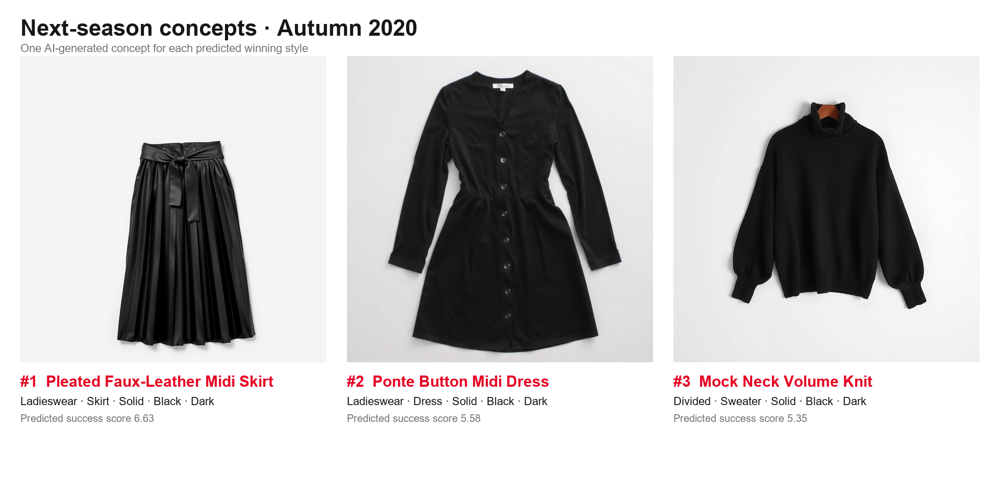

# Next-Season Style Intelligence Platform

Predict the fashion styles most likely to perform strongly next season, turn them into new product
concepts with generative AI, and let business users explore the results through an API and a web app.

```
Retail Data → Data Processing → ML Model → Prediction Output → Backend API → Frontend → Business User
```

> 🚧 Work in progress. Sections marked _TBD_ will be filled in as the project develops.

## Data

[H&M Personalized Fashion Recommendations](https://www.kaggle.com/competitions/h-and-m-personalized-fashion-recommendations) (Kaggle).

| File | Used | Purpose |
|---|---|---|
| `transactions_train.csv` | ✅ | 31.8M rows, one row per unit sold (2018-09-20 → 2020-09-22): date, customer, article, scaled price, channel |
| `articles.csv` | ✅ | 105,542 articles with product attributes; used to define styles |
| images | ✅ (subset) | Visual reference for the top styles and concept generation |
| `customers.csv` | ❌ | Not required by the brief; customer behaviour is derived from `customer_id` in transactions |
| `sample_submission.csv` | ❌ | Belongs to the original recommendation competition |

Place the raw CSVs in `kaggle_downlods/` (git-ignored).

### Data subset

- **Transactions: all of them, no sampling.** The data isn't too big for a laptop (16 GB RAM): as a Parquet
  cache the transactions take 0.77 GB on disk and ~0.7 GB in memory, and load in seconds. Using everything avoids
  sampling bias. The days 1–22 Sep 2020 belong to the prediction quarter and are not used as model input.
- **Cleaning: 376 articles removed, together with their transactions (99.6% of revenue kept).**
  - Non-fashion product groups: Items, Cosmetic, Furniture, Garment and Shoe care, Interior textile, Stationery,
    Fun (98 articles, ~0.01% of revenue). They have no style to predict.
  - Articles with an unknown/undefined value in a style attribute (278 articles, ~0.4% of revenue). Their style isn't defined.
  - This leaves 105,166 articles and 31,653,188 transactions. Implemented in `data_science/data.py` (`load_articles`).
  - Kept on purpose: identical transaction rows (~9%, multiple units, since there is no quantity column), very low prices
    (~0.01% of revenue) and bulk purchases (~0.2% of revenue). Details in
    [`03_data_quality_and_eda.ipynb`](data_science/notebooks/03_data_quality_and_eda.ipynb).
- **Images: only the ones the app shows.** The full set is ~29 GB. The app shows the top 3 styles of every season
  (actual winners for past seasons, predicted ones for the next quarter), each with its 5 best-selling articles of that
  season: **93 images instead of ~105k**. A style contains hundreds of articles (the black dress style alone has 877), so
  its best sellers act as representatives. The images are only used for display and as reference for concept generation;
  the model never uses images, so this subset introduces **no bias in the predictions**. Each quarter `predict.py` writes
  the list (`outputs/images_needed.csv`) and fetches only the images not yet present.
- **COVID is kept and flagged.** Store sales are missing from 2020-03-20 to 2020-05-05 (all sales are online).
  Style rankings in Spring 2020 stay about as stable as in normal quarters, because the success score compares
  styles within their category, so the quarter is kept.

## Key definitions

### What is a "style"?

A style is the set of attributes that together define a customer's style choice. It has to be:

- **Exhaustive**: changing any attribute *outside* the set doesn't change the style.
- **Non-redundant**: changing the value of any attribute *inside* the set gives a different style.

```
style = index_group + product_type + graphical_appearance + colour_group + perceived_colour_value
e.g.    Ladieswear  · Dress        · All over pattern     · Light Pink   · Dusty Light
```

| Attribute | Why it is included |
|---|---|
| `index_group_name` | Who it is for (Ladieswear / Menswear / Divided / Baby-Children / Sport). 80% of articles would otherwise be in styles that mix different customer segments |
| `product_type_name` | What it is (dress, trousers, hoodie, ...) |
| `graphical_appearance_name` | Surface design: pattern and texture (solid, stripe, denim, lace, ...) |
| `colour_group_name` | The specific colour (50 values) |
| `perceived_colour_value_name` | Tone (dark / light / dusty light / bright). Splits the same colour into meaningfully different looks, e.g. Red is 49% Medium / 47% Bright |

Excluded: identifiers (`article_id`, `product_code`, `prod_name`); columns that duplicate an included one
(`product_group_name`, `index_name`, `perceived_colour_master_name`); and internal merchandising
structure (`department_name`, `section_name`, `garment_group_name`).

**Why not articles or product codes?** Most articles are replaced every season, so next season's
articles mostly don't exist yet. Attribute-based styles recur across seasons and have history to learn from.

**Known gap:** fit, length, neckline and fabric only exist in free text (`detail_desc`) and images,
so they are not part of the style.

### What is a "successful" style?

A style is successful if it earns strong full-price revenue **relative to the demand of its category**.
Category = `index_group + product_type`.

```
Adjusted revenue = Revenue × (Revenue ÷ Full-price revenue)
Group benchmark  = Σ Adjusted revenue² ÷ Σ Adjusted revenue      (over styles in the same category)
Success score    = Adjusted revenue ÷ Group benchmark
```

- **Full-price revenue** is what the units would have earned at each article's highest observed price,
  so discounting lowers the score.
- **Group benchmark** is the revenue-weighted typical style size of the category. Styles are weighted by
  revenue, so a long tail of tiny styles barely affects it. A score of 1 means "as good as the typical
  style a sale in this category comes from".
- Styles are ranked by success score. There is no minimum-size floor: a small style that beats its category
  performed well. Whether that success repeats is left to the prediction model (`articles` will be a feature).

Checked on Summer 2019, Autumn 2019 and Summer 2020
([`01_style_and_success_definition.ipynb`](data_science/notebooks/01_style_and_success_definition.ipynb)):

- Raw revenue puts only Ladieswear basics in the top 10. The success score's top 50 comes from 45–48 different categories.
- Scores are fairly stable from season to season (rank correlation 0.51–0.75; about half of the top 50 carries over), so the problem is predictable but not trivial.
- Very small styles are rare at the top: 1–3 of the top 50 per season have fewer than 5 articles.

### ⚠️ Flag: supply vs. demand

The top styles in each category are mostly solid black/white basics. Part of that comes from H&M's own
supply decisions: for example, H&M offered 104 black solid skirts versus a handful in most other colours,
so they naturally earned more in total. **The success score therefore partly reflects H&M's buying plan,
not only what customers prefer.** We accept this deliberately: these styles really did perform best,
and predicting what performs is the goal. Without stock/assortment data we can't fully separate the two effects.

### Prediction period

**Autumn 2020: 1 Sep – 30 Nov 2020**, predicted from data up to 31 Aug 2020.

We predict the best three styles for **one quarter**, assuming production and restocking decisions are made
quarterly. The success score is aggregated over the whole quarter, because that is the level at which
"what should we produce" is decided.

Quarters follow the fashion seasons: Spring (Mar–May), Summer (Jun–Aug), Autumn (Sep–Nov), Winter (Dec–Feb).
They line up with the half-year switch points seen in the data (styles' success changes around 1 March and
1 September), while calendar quarters would mix summer and autumn styles.

Evidence ([`02_eda_trends.ipynb`](data_science/notebooks/02_eda_trends.ipynb)):

- **Long enough to be reliable.** Scoring each style separately from the odd and even days of the same period,
  the two rankings agree at 0.97 for ~91-day periods (top-50 overlap 0.90). Noise only matters below about a month.
- **Strong seasonality.** A style's success correlates with the same dates a year later (median +0.55 for the
  top 300 styles) and negatively with the opposite half-year (−0.43). So "same quarter last year" is useful history.
- **Short enough for the data.** The two years contain 8 quarters, 4 of which have the same quarter a year earlier.
  Half-year seasons would leave only 4 periods, with just 2 of them having a year-earlier equivalent.

The 22 days of September 2020 in the data belong to the target quarter. They are not used as model inputs.

## Modelling approach

### The problem

- **Unit:** one row per style per quarter
  ([`04_style_quarter_table.ipynb`](data_science/notebooks/04_style_quarter_table.ipynb)).
- **Target:** that quarter's success score.
- **Output:** a ranking of styles for the next quarter; the top 3 are the winners.
- **Shape:** three properties decide the model:
  - **Very short history per style:** at most 8 quarters, i.e. two seasonal cycles.
  - **Many related styles:** ~23k styles share categories, colours, patterns and seasons, so a model can learn across styles.
  - **Only the top of the ranking matters:** the target is heavily skewed (90% of style-quarters score below 0.25, the best ~4–5)
    and about half of the rows are zero. Business users also need an explanation for every prediction.

### Models considered

| Family | Verdict | Reason |
|---|---|---|
| Baseline: last quarter's success score | **Baseline** | The simplest forecast: "next quarter looks like last quarter". Success persists between quarters, so it is a real bar to beat. |
| Per-style time series (ARIMA, ETS, Prophet, Croston) | Rejected | See below. |
| Deep learning (DeepAR, N-BEATS, Temporal Fusion Transformer, tabular MLP/TabNet) | Rejected | See below. |
| Pretrained time-series models (Chronos, TimesFM) | Rejected | Forecast a single numeric series; our target is a relative score that depends on the other styles, and each series has ≤ 8 points. |
| **Ridge regression** on engineered features, one model across all styles | **Final model** | Linear, deterministic, fast, and every prediction decomposes exactly into feature contributions. (On 145k rows the ridge penalty has no measurable effect, so it is effectively linear regression.) |
| **LightGBM** (gradient-boosted trees) on the same features | Compared | The standard non-linear model for tabular retail forecasting. Tests whether interactions and non-linear effects add anything. A learning-to-rank variant was also tried and ranked worse at the top. |
| Hierarchical / Bayesian panel model | Future improvement | Shrinks small styles towards their category; interpretable, but slower to build. |
| Image embeddings (CLIP/CNN) as features | Future improvement | Could capture fit and silhouette, which the attributes miss; needs the ~29 GB image set. |
| Customer-level signals (early adopters, purchase embeddings) | Future improvement | Styles bought early by "trend-leading" customers may rise next; needs customer-level modelling. |

**Why not per-style time series.** Classical models (ARIMA, ETS, Prophet) fit one series at a time. Each style has
at most 8 quarterly points, and with a seasonal period of 4 that is only two cycles: too few to estimate trend
*and* seasonality without fitting noise. They also learn nothing from the other 23k styles, while the strongest
signals here are shared (e.g. "black solid basics persist", "sweaters rise in autumn"). New and young styles,
with 1–3 quarters of history, can't be modelled at all.

**Why not deep learning.** Sequence models (DeepAR, N-BEATS, TFT) learn patterns along time and need long series,
typically dozens to hundreds of steps per series; we have 8. Moving to weekly data would give ~100 steps, but the
decision and the target are quarterly, the models are data-hungry and slow to tune on a laptop, and their
predictions are hard to explain to business users, which the brief requires. Tabular deep learning
(MLP, TabNet) rarely beats simpler models on ~100k rows. The limiting factor is the length of history, which
no architecture can add.

**What we do instead.** Turn each style's history into features (lags, same quarter last year, recent weeks,
seasonal share, category trends, attributes) and train **one model across all styles**. A short history becomes
usable because the model learns from 145k style-quarters at once.

### Features

All features for a quarter use only data from before the quarter starts (`data_science/features/build.py`):

| Group | Features |
|---|---|
| Style history | success score 1–4 quarters ago (4 = same quarter last year), 4-quarter mean / max / trend, quarters sold, age, time since last sale, last quarter's revenue, units, articles and full-price factor |
| Recent momentum | success score in the last 4 weeks, revenue momentum, new articles launched in the last 13 weeks |
| Seasonality | target season; share of the style's and its category's past revenue earned in that season |
| Attributes | segment, product type, pattern, colour, tone (categorical) |
| Attribute momentum | is the style's colour / pattern / tone gaining share of all revenue, year on year? |
| Category context | category growth, number of competing styles, category benchmark |
| Customers and price | buyers last quarter, repeat-purchase rate, online share, price relative to the category |

### Evaluation

Full walk-through with code: [`05_modelling.ipynb`](data_science/notebooks/05_modelling.ipynb).

- **Business rule, commercially relevant styles:** only styles whose revenue last quarter was in the **top 10% of styles
  that sold** can be recommended (~1,200–1,300 styles per quarter). It uses only pre-quarter data, so it also applies to
  the final prediction. All results are among these styles: our picks and the true winners both come from this pool.
  Without the rule, most misses were small kids' styles jumping suddenly in a small category (e.g. a kids' sweater going
  from 0.40 to 4.75 in summer): not predictable from history and of little commercial weight.
- **Baseline: last quarter's success score**, the "do nothing" forecast a merchandiser would make. Success persists
  (rank correlation with last quarter 0.68–0.79), so it is a real bar to beat.
- **Walk-forward:** each evaluated quarter is predicted by models trained on all earlier quarters.
  **Validation: Autumn 2019 + Winter 2019** (choose the metric and the model). **Test: Spring 2020 + Summer 2020**
  (report the chosen model only; the validation quarters are part of its training data).
- **Metric: top-3 quality**: the average actual success score of the three styles we pick ÷ the average actual score of
  the true top three (1.0 = the best possible picks). It measures the decision itself, which three styles to produce,
  and gives credit for near-misses. Top-10/top-50 quality, NDCG@50 and Spearman are reported as context.

### Results

**Validation** (mean of Autumn 2019 and Winter 2019):

| Model | **Top-3 quality** | Top-10 quality | Top-50 quality | NDCG@50 | Spearman |
|---|---|---|---|---|---|
| Baseline: last quarter | 0.863 | 0.929 | 0.925 | 0.922 | 0.765 |
| **Ridge** | 0.930 | **0.980** | **0.958** | **0.951** | **0.851** |
| LightGBM (5-seed average) | **0.946** | 0.947 | 0.950 | 0.943 | 0.846 |

| Top-3 quality | Autumn 2019 | Winter 2019 | Mean | Worst quarter |
|---|---|---|---|---|
| Baseline: last quarter | 0.858 | 0.869 | 0.863 | 0.858 |
| **Ridge** | 0.911 | **0.949** | 0.930 | **0.911** |
| LightGBM | **0.994** | 0.899 | **0.946** | 0.899 |

**Choice: ridge.** Both models beat the baseline in both validation quarters. LightGBM's slightly higher top-3 mean
comes entirely from one quarter (Autumn 2019), and it loses Winter 2019. Ridge has the better worst quarter, is ahead on
every other metric, gives the same picks every run (single-seed LightGBM ranged 0.83–0.98 on Winter 2019), and its
explanations are exact. The choice was fixed before looking at the test quarters.

**Test** (mean of Spring 2020 and Summer 2020):

| Model | **Top-3 quality** | Top-10 quality | Top-50 quality | NDCG@50 | Spearman |
|---|---|---|---|---|---|
| Baseline: last quarter | 0.906 | 0.886 | 0.909 | 0.906 | 0.759 |
| **Ridge** | **0.973** | **0.943** | **0.950** | **0.946** | **0.882** |

- Ridge clearly beats the baseline in Spring 2020 (0.955 vs 0.819), the COVID quarter when last quarter's pattern broke,
  and matches it in Summer 2020 (0.992 each), when the true winners were exactly last quarter's leaders.
- Over all four evaluated quarters, ridge beats the baseline in three and ties in one.

**Why a linear model is enough.** The relationship between a style's recent performance and its next-quarter
performance is close to a straight line (on the log scale):

- One straight line on a single feature, the success score in the last 4 weeks, explains **65%** of the variance
  of next quarter's (log) score on the test quarter. Ridge with all features reaches **69%**, LightGBM **71%**.
  The non-linear model adds only ~2 points.
- LightGBM's learned effect of the last-4-weeks score rises steadily and then **flattens above ~1.5**: trees cannot
  extrapolate beyond the values in a leaf, so the strongest styles all get similar predictions. That is exactly where
  the top three are decided, and where a linear model, which keeps increasing, separates them better.
- Most of the signal is persistence (recent and average past success) plus seasonality, both of which are additive.

### Final model and prediction

`python -m data_science.train` evaluates and then trains ridge on all labelled quarters, validation and test included
(`models/ridge.joblib`).
`python -m data_science.predict` scores every style for Autumn 2020 (`outputs/predictions.csv`) and writes each
prediction's largest feature contributions (`outputs/explanations.parquet`), plus each style's quarterly history and
best-selling articles for the API. Because the model is linear, a prediction is
exactly the average prediction plus the sum of contributions, coefficient × (feature value − training average),
which equals its SHAP values. The predicted score is on the success-score scale; values above the historical maximum
reflect linear extrapolation and only the ranking is used.

**Predicted winning styles for Autumn 2020** (1 Sep – 30 Nov 2020, among commercially relevant styles):

| Rank | Style | Main reasons (largest contributions) |
|---|---|---|
| 1 | Ladieswear · Skirt · Solid · Black · Dark | very strong last 4 weeks (score 3.97) and 4-quarter average (3.66) |
| 2 | Ladieswear · Dress · Solid · Black · Dark | strong last 4 weeks (3.41) and average (3.40); 85 new articles launched in the last 13 weeks |
| 3 | Divided · Sweater · Solid · Black · Dark | strong 4-quarter average (3.78); 4.13 in the same quarter last year |

## Backend API

FastAPI service exposing the predictions (`backend/`). It reads only the artifacts written by
`python -m data_science.predict` (`outputs/predictions.csv`, `explanations.parquet`, `style_history.parquet`,
`style_articles.parquet`), so it contains no ML code and runs without the raw Kaggle data.

| File | Role |
|---|---|
| `backend/api.py` | routes, validation, error handling (FastAPI app factory `create_app`) |
| `backend/model_service.py` | loads the model outputs and builds responses (ranking, explanations, history) |
| `backend/images.py` | local image store that fetches a missing image on first request |
| `backend/schemas.py` | response models (Pydantic); they generate the OpenAPI docs |
| `backend/tests/test_api.py` | endpoint tests (`pytest backend/tests`) |

```bash
.venv/Scripts/python -m uvicorn backend.api:app --reload    # interactive docs: http://localhost:8000/docs
.venv/Scripts/python -m pytest backend/tests
```

| Endpoint | Purpose |
|---|---|
| `GET /health` | service status, prediction quarter, number of styles |
| `GET /styles/top?limit=3` | the top predicted styles (1–50), each with style ID, prediction score, category and sales history |
| `GET /styles?limit=20&offset=0&segment=&product_type=&include_all=false` | the full ranking, paginated and filterable |
| `GET /styles/{style_id}` | product information, prediction score, model explanation and historical performance; **404** for an unknown `style_id` |
| `GET /seasons` | the app's timeline: past seasons (`actual`), the next quarter (`predicted`), the 4 after it (`coming_soon`) |
| `GET /seasons/{quarter_id}` | a season's top 3 styles with success score, a plain-language explanation of the score, their 5 best-selling articles of that season, and (predicted season) the generated concept; empty for `coming_soon`, **404** for an unknown season |

Scores in every style object:

- `prediction_score`: the predicted success score for the quarter (1 = as good as a typical style of its category). The
  model is linear on log(1 + score), so for the strongest styles it extrapolates above the historical maximum (~4.75);
  only the ranking is validated.
- `relative_score`: `prediction_score` ÷ that of the #1 style (1.0 = top style), an easy 0–1 reading.
- `percentile`: share of the other ranked styles the style is ahead of (#3 of 1,272 → 0.998).

Example, `GET /styles/top?limit=1`:

```json
{
  "quarter": "2020_autumn",
  "candidates": 1272,
  "styles": [{
    "rank": 1,
    "style_id": "ladieswear__skirt__solid__black__dark",
    "name": "Ladieswear · Skirt · Solid · Black · Dark",
    "category": "Ladieswear · Skirt",
    "prediction_score": 6.627,
    "relative_score": 1.0,
    "percentile": 1.0,
    "units_last_quarter": 10370,
    "image_url": null,
    "sales_history": [{"quarter_id": "2020_summer", "season": "summer", "success_score": 4.474,
                       "revenue": 359.809, "units": 10370, "articles": 113}]
  }]
}
```

(`sales_history` lists all eight quarters; shortened here.) `GET /styles/{style_id}` adds the attributes, the
best-selling articles (name, description, Kaggle image path), and an explanation:

```json
"explanation": {
  "summary": "Ranked #1 of 1,272 commercially relevant styles for Autumn 2020. Main drivers: success score in the last 4 weeks: 3.97; average success score over the last 4 quarters: 3.66.",
  "contributions": [
    {"feature": "score_last4w", "label": "Success score in the last 4 weeks", "value": "3.97", "contribution": 1.173, "effect": "raises"},
    {"feature": "score_mean4", "label": "Average success score over the last 4 quarters", "value": "3.66", "contribution": 0.534, "effect": "raises"}
  ]
}
```

Images: the API returns an `image_url` for each style (its best-selling article) and each article. The source is
configurable, so a new quarter needs no backend change:

- **Default, local files:** `python -m data_science.predict` fetches the images listed in `outputs/images_needed.csv`
  (each season's top 3 styles × 5 articles, only those still missing) into `outputs/images/<style_id>/` as its last step;
  the API serves them at `/images/<style_id>/<article_id>.jpg`. It uses the Kaggle API (`kaggle auth login` once). Without a login, prediction still
  completes and prints a warning; run `python -m data_science.fetch_images` later, or `--from-dir <folder>` to copy
  images downloaded by hand.
- **Image store / CDN:** set `IMAGE_URL_TEMPLATE`, e.g. `https://cdn.example.com/images/{prefix}/{article_id}.jpg`, and
  the API builds the URLs from it with no local files. This is how it would run in production.
- **On demand:** any image the app shows that isn't on disk yet is fetched from Kaggle the first time it is requested
  (`GET /images/<style_id>/<article_id>.jpg`, about 4 s) and kept, so later views are instant. Only images of articles
  the app can show are fetched (season winners and style detail articles); any other request returns 404. Without a
  Kaggle login the request returns 404 and the app shows a placeholder. Disable with `IMAGES_ON_DEMAND=0`.
  The Kaggle download code is shared by the pipeline and the API (`data_science/image_source.py`).
- If an image is unavailable, the frontend shows a placeholder. Every article also carries its `kaggle_image_path`.

## Frontend

React + TypeScript + Tailwind (`frontend/`), consuming the API.

```bash
cd frontend
npm install
npm run dev            # http://localhost:5173 (expects the API on http://localhost:8000; override with VITE_API_URL)
```

- **Season timeline:** every past season (Winter 2018 → Summer 2020) shows its **actual** top 3 styles, the next quarter
  (Autumn 2020) shows the **predicted** top 3 with an AI-generated concept per style, and later seasons show
  "Coming soon", since predictions are made one quarter ahead. Autumn 2018 is left out: the data starts on 20 Sep 2018,
  and without a previous quarter the business rule can't be applied.
- **Pinterest-style boards:** each winning style is a board of its 5 best-selling articles of that season
  (for the predicted season: of the last quarter), with the concept pinned first.
- **Score:** every style shows its raw success score. Hovering explains it in plain words, e.g. *"4.47: this style
  earned about 4.5× as much as a typical Ladieswear skirt style in Summer 2020, on revenue adjusted for discounts"*.
  Predicted scores add that the best score seen in past seasons is 4.49, so values above it read as "very strong": the
  model is validated on the ranking, not on the exact value.
- **Detail view** (Details button): the style's images, attributes, the prediction for the next quarter (score, rank,
  percentile, summary), the reasoning (feature contributions) and its historical performance per quarter.

| File | Role |
|---|---|
| `src/api.ts` | typed API client |
| `src/App.tsx` | page: timeline, season view, coming soon |
| `src/components/SeasonTimeline.tsx` | season selector |
| `src/components/StyleBoard.tsx`, `PinCard.tsx` | a style's masonry board and its cards |
| `src/components/ScoreBadge.tsx` | score with hover explanation |
| `src/components/StyleDetail.tsx`, `SalesChart.tsx` | detail view and history chart |

## Next-season concepts (generative AI)



`python -m data_science.generate_concepts` creates one new product concept for each predicted winning style.
Full explanation per concept, **Predicted Style → Key Success Factors → New Product Concept**:
[`outputs/concepts_explanation.md`](outputs/concepts_explanation.md).

| Rank | Predicted style | Concept |
|---|---|---|
| 1 | Ladieswear · Skirt · Solid · Black · Dark | **Pleated Faux-Leather Midi Skirt**: high-waisted, sharp knife pleats, matching tie belt |
| 2 | Ladieswear · Dress · Solid · Black · Dark | **Ponte Button Midi Dress**: structured ponte jersey, V-neck, long sleeves, covered front buttons |
| 3 | Divided · Sweater · Solid · Black · Dark | **Mock Neck Volume Knit**: boxy knit, structured mock neck, voluminous balloon sleeves |

How it works, in two steps per style (both on free tiers):

1. **Design: Gemini (`gemini-3.8-flash`, sees images).** The prompt contains only what shapes the design: the season,
   the style's attributes, and its **5 best-selling articles: photos attached plus their H&M descriptions**. Gemini returns
   a very detailed specification (silhouette, length, waist/closures, fabric and weight, texture, construction, details,
   hem, colour), what it **keeps** from the best sellers (naming which ones), what it **changes** for the season and why,
   and a render-ready image prompt. Saved per style in `outputs/concepts/<style_id>.json`.
2. **Render: FLUX.1 schnell on Cloudflare Workers AI** (free plan: 10,000 neurons/day; a concept costs well under 100)
   turns the image prompt into a flat-lay catalogue photo.

Then the three are assembled into `outputs/generated_concepts.png`, and the app shows each concept as the first pin of
its style in the predicted season. The model's success factors are deliberately **not** in the prompt: sales numbers
don't shape a garment's design. They appear in the explanation instead.

Why this setup: Gemini's image models have no free API quota (free-tier limit 0) and Claude doesn't generate images, so
the design is done by a free model that can see the photos, and the rendering by a free text-to-image model. Only
missing designs/images are generated, so re-running each quarter only creates the new winners' concepts
(`--force` regenerates all).

Credentials go in environment variables or the git-ignored `.env` file: `GEMINI_API_KEY` (Google AI Studio),
`CLOUDFLARE_ACCOUNT_ID` and `CLOUDFLARE_API_TOKEN` (Cloudflare "Workers AI" token template).

## Limitations

- **No stock data.** Sales measure demand only where items were available. A sold-out style looks weaker
  than it was, and the success score can't tell supply apart from demand (see flag above).
- Prices are scaled by Kaggle, so only comparisons between prices are meaningful.
- **A style counts in its own group benchmark.** A strong style raises its category's benchmark and so
  lowers its own score; in the extreme, a style that dominates its category scores ≈ 1. We tested a
  leave-one-out benchmark (built only from the *other* styles in the category). It removed this effect,
  but categories with only 2–3 styles produced extreme scores (> 100), and even with size floors the
  winners became "default colour" categories (black belts, tights, leggings, ballerinas). So we kept the
  inclusive benchmark for now. Single-style categories are negligible either way (≈ 0.1% of revenue).

## Project structure

```
data_science/
  data.py                     # loads and cleans the raw CSVs (Parquet cache of transactions in data/)
  features/
    style.py                  # style definition and style_id
    success.py                # success score
    quarters.py               # fashion quarters and the style × quarter table
    build.py                  # feature engineering
  train.py                    # walk-forward evaluation + final model training
  predict.py                  # scores the prediction quarter, writes the API artifacts, fetches the images
  fetch_images.py             # fetches the article images the app shows (only missing ones)
  generate_concepts.py        # next-season concepts: Gemini designs from the best sellers, FLUX renders
  image_source.py             # Kaggle image download, shared by the pipeline and the API
  notebooks/
    01_style_and_success_definition.ipynb   # style and success metric decisions
    02_eda_trends.ipynb                     # how style success changes over time → prediction period
    03_data_quality_and_eda.ipynb           # data quality, cleaning, sales/product/category/customer EDA
    04_style_quarter_table.ipynb            # the style × quarter table and its target
    05_modelling.ipynb                      # baseline, models, metric, model choice, test, Autumn 2020 prediction
models/ridge.joblib           # final model
outputs/                      # evaluation.csv, predictions.csv + API artifacts (explanations, history, articles)
backend/
  api.py                      # FastAPI routes
  model_service.py            # reads model outputs, builds responses
  schemas.py                  # response models
  tests/test_api.py
frontend/                     # React app: season timeline, Pinterest-style boards, style detail view
```

## Setup

```bash
python -m venv .venv
.venv/Scripts/pip install -r requirements.txt      # Windows (use .venv/bin/pip on macOS/Linux)
.venv/Scripts/python -m data_science.train      # evaluate + train the final model
.venv/Scripts/kaggle auth login                # once: lets the pipeline fetch the 93 images the app shows
.venv/Scripts/python -m data_science.predict    # predict Autumn 2020, write the API artifacts, fetch the images
.venv/Scripts/python -m uvicorn backend.api:app  # serve the API (http://localhost:8000/docs)
.venv/Scripts/python -m data_science.generate_concepts  # next-season concepts (needs the keys in .env)
cd frontend && npm install && npm run dev         # the app (http://localhost:5173)
```
