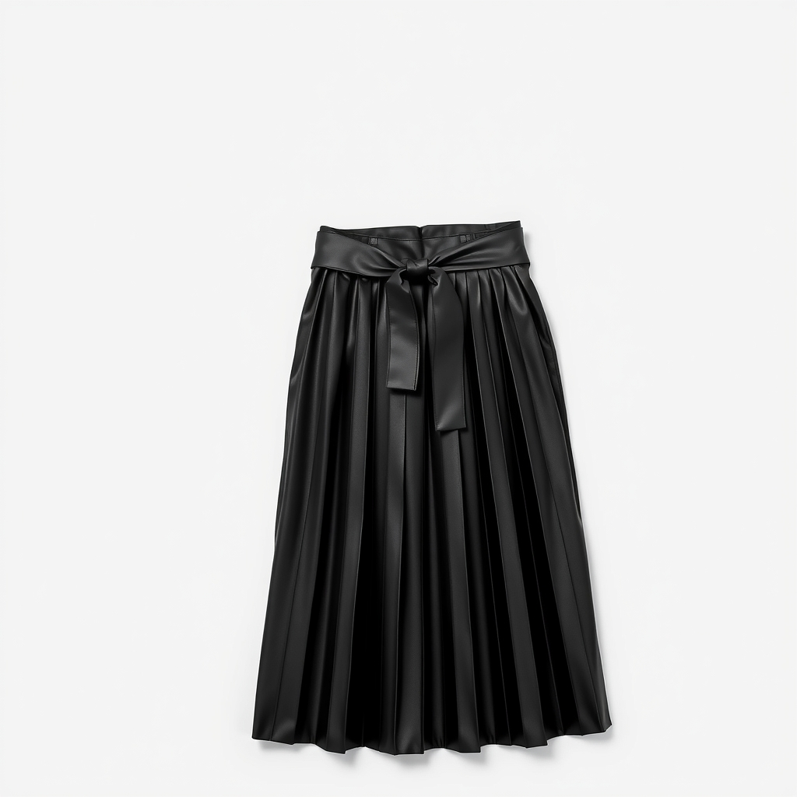
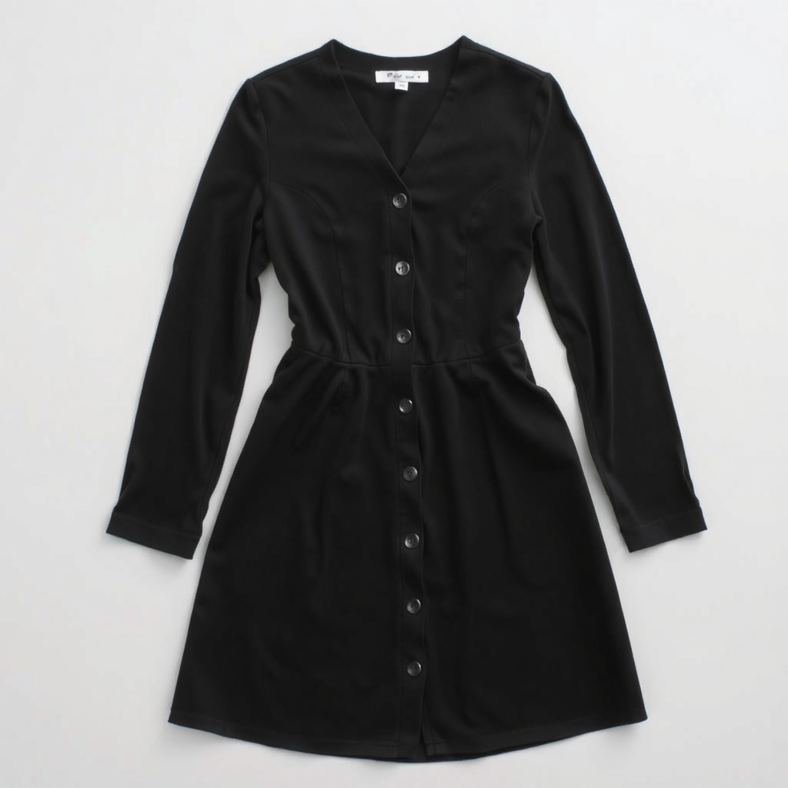
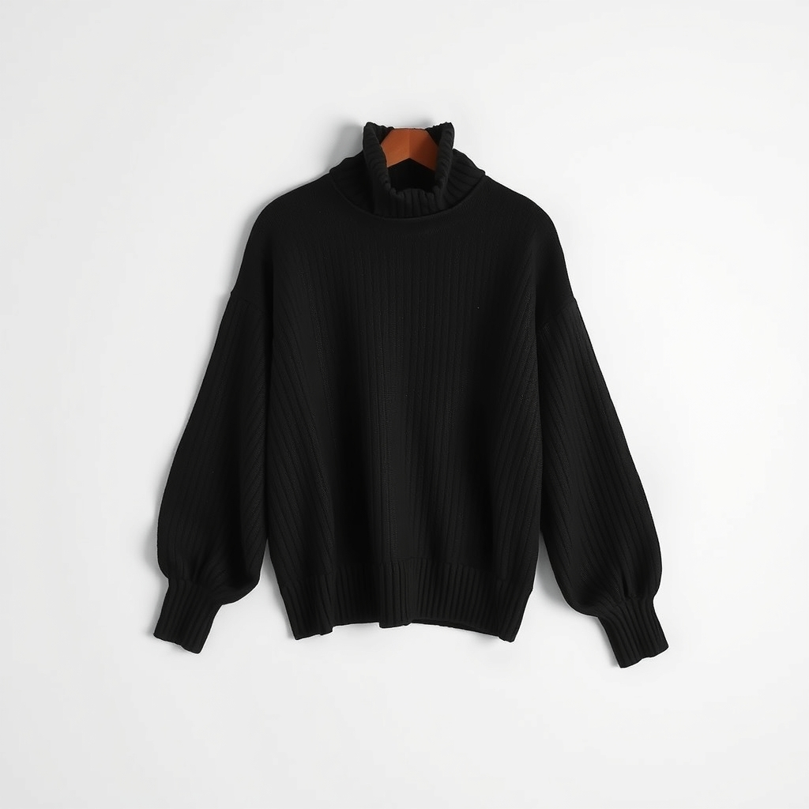

# Next-season concepts · Autumn 2020

Each concept follows **Predicted Style → Key Success Factors → New Product Concept**. Gemini designed each concept from the style's attributes and its 5 best-selling articles (photos and descriptions); FLUX.1 schnell (Cloudflare Workers AI) rendered it. The success factors come from the prediction model.

## #1 Ladieswear · Skirt · Solid · Black · Dark

**Predicted style:** Ladieswear · Skirt · Solid · Black · Dark, predicted success score 6.63 (≈ 6.6× a typical Ladieswear skirt style).

**Key success factors** (largest contributions to the prediction):
- Success score in the last 4 weeks: 3.97
- Average success score over the last 4 quarters: 3.66
- Success score last quarter: 4.47
- Success score in the same quarter last year: 3.34
- Best sellers last quarter: Tuby skirt, Florida skirt, Cezanne, Libra skirt, Tangerine

**New product concept: Pleated Faux-Leather Midi Skirt**

A versatile high-waisted midi skirt in solid black faux leather with sharp knife pleats and a matching tie belt.

Keeps:
- High-rise comfortable waist construction (Florida, Tangerine, Cezanne)
- Calf-length fluid midi proportion (Florida, Cezanne)
- Removable self-fabric tie belt for waist definition (Libra)

Changes:
- Replaced lightweight viscose and jersey with structured matte faux leather for autumn weather protection and warmth
- Introduced heat-set knife pleats for structured seasonal drape and heavier volume
- Tailored length to sit mid-calf to pair with autumn boots

Full design specification

- **Silhouette and fit:** A-line silhouette fitted at the natural waist and falling into a flared, pleated midi skirt.
- **Length and proportions:** Mid-calf length measuring 78 cm from waist to hem with a 4 cm wide waistband.
- **Waist neckline and closures:** High waist with a flat front panel, elasticated back casing, side-seam invisible zipper, and self-fabric tie belt.
- **Fabric and weight:** Medium-weight polyurethane faux leather with a brushed polyester knit backing (240 gsm).
- **Texture and surface:** Fine-grained matte finish that holds sharp pleats while remaining supple.
- **Construction and seams:** Vertical 2 cm knife pleats heat-set throughout; clean side seams with concealed closure.
- **Details and trims:** Four narrow thread belt loops at the waist accommodating a 4 cm wide self-tie belt.
- **Hem and finishing:** Clean laser-cut raw hem maintaining crisp pleat edges without bulk.
- **Colour and finish:** Solid deep ink-black with a low-lustre, water-resistant matte finish.

Laid completely flat, the skirt displays an A-line midi silhouette in deep black matte faux leather. The top features a tailored 4 cm waistband that is smooth across the front, flanked by small thread belt loops securing a matching flat tie belt tied at the centre. Extending directly from the waistband, uniform 2 cm knife pleats cascade down the full body of the garment, creating distinct vertical shadow lines and structured volume. The fabric presents a smooth, supple leather-like grain with a subtle low-sheen finish. At the bottom, the mid-calf hem finishes with a clean, unstitched laser-cut edge that allows the pleats to hang sharply.

## #2 Ladieswear · Dress · Solid · Black · Dark

**Predicted style:** Ladieswear · Dress · Solid · Black · Dark, predicted success score 5.58 (≈ 5.6× a typical Ladieswear dress style).

**Key success factors** (largest contributions to the prediction):
- Success score in the last 4 weeks: 3.41
- Average success score over the last 4 quarters: 3.39
- New articles launched in the last 13 weeks: 85.00
- Success score last quarter: 3.74
- Best sellers last quarter: Romeo dress, Amalia, Nora dress(1), CS Paula dress, Sorrel

**New product concept: Ponte Button Midi Dress**

An Autumn-ready black midi dress in structured Ponte jersey, detailed with a clean V-neck, long sleeves, and front covered buttons.

Keeps:
- Subtle, clean-finished V-neckline (Romeo, CS Paula)
- Vertical centre-front covered button placket (CS Paula)
- Defined horizontal waist seam transitioning into an A-line skirt (Romeo, CS Paula)

Changes:
- Replaced short sleeves with full-length slim sleeves to provide essential Autumn warmth and layering utility.
- Extended the skirt length from mini/knee to a 115 cm midi hem to suit cooler seasonal temperatures and pair with boots.
- Upgraded fabric from light cotton jersey to a mid-weight 290 gsm Ponte Roma double-knit for seasonal structure and drape.

Full design specification

- **Silhouette and fit:** Fitted through the bodice and natural waist, releasing into a gently flared A-line midi skirt.
- **Length and proportions:** Midi length finishing roughly 15 cm below the knee (115 cm back length for size 36). Balanced with full-length slim sleeves.
- **Waist neckline and closures:** An 18 cm deep V-neckline with self-facing. Fastened down the centre front by ten functional covered buttons ending at mid-thigh.
- **Fabric and weight:** Medium-weight 290 gsm compact Ponte Roma knit (viscose/polyester/elastane blend) offering thermal comfort and shape retention.
- **Texture and surface:** Dense, ultra-smooth double-knit jersey with two-way stretch and a low-sheen, uniform surface.
- **Construction and seams:** Fitted bust darts, set-in sleeves, horizontal waistline seam, and reinforced overlocked internal construction.
- **Details and trims:** Ten 14 mm self-fabric dome buttons placed at 4.5 cm intervals along the centre front.
- **Hem and finishing:** Blind-stitched 2.5 cm turned hemline at the skirt and twin-needle 2 cm sleeve cuffs. Unlined finish.
- **Colour and finish:** Solid deep black (Pantone 19-4008 TCX) with an opaque, light-absorbing matte finish.

A solid jet-black long-sleeved midi dress laid completely flat. At the top, the garment features an open, clean-finished V-neckline leading directly into a tailored central front placket. The placket runs vertically down the bodice and into the skirt, secured with a row of ten self-fabric covered dome buttons. The dress is constructed with narrow set-in shoulders and full-length, straight sleeves that finish with clean 2 cm folded cuffs. A clear horizontal seam defines the natural waistline, separating the fitted upper bodice from the lower section. Below the waist seam, the skirt transitions into a gently flared A-line silhouette, cut with fluid drape that falls smoothly to a calf-length midi hem. The hemline is straight across the front and back, finished with a subtle blind stitch. The double-knit Ponte fabric presents a flat, smooth, and matte deep-black surface with clean seam lines throughout. The entire garment is unlined, showcasing crisp edge finishes and a classic, structured high-street design.

## #3 Divided · Sweater · Solid · Black · Dark

**Predicted style:** Divided · Sweater · Solid · Black · Dark, predicted success score 5.35 (≈ 5.3× a typical Divided sweater style).

**Key success factors** (largest contributions to the prediction):
- Success score in the last 4 weeks: 2.91
- Average success score over the last 4 quarters: 3.78
- Success score in the same quarter last year: 4.13
- Success score 3 quarters ago: 4.49
- Best sellers last quarter: Vic Volume Sleeve Sweater, Shelly Polo Neck, Jessica Long Sweater, Lisa LS, Fazer balloon sweater

**New product concept: Mock Neck Volume Knit**

A contemporary high-street black boxy knit combining a structured mock neckline with voluminous balloon sleeves for transitional Autumn 2020 styling.

Keeps:
- Voluminous balloon sleeves with elongated ribbed cuffs from the Vic Volume Sleeve Sweater and Fazer Balloon Sweater.
- Pronounced dropped-shoulder armhole construction seen across the Vic, Jessica, and Fazer sweaters.

Changes:
- Added a clean standing mock neckline to provide transitional autumn warmth and elevated layering.
- Utilised a textured 7-gauge half-cardigan rib stitch to introduce seasonal depth and tactile structure.

Full design specification

- **Silhouette and fit:** Relaxed, boxy torso paired with exaggerated balloon sleeves tapered sharply at the wrists.
- **Length and proportions:** High-hip crop measuring approximately 48 cm in total body length, designed to sit cleanly over high-rise trousers.
- **Waist neckline and closures:** Features a 4.5 cm standing mock neckline in a 1x1 rib with no hardware or closures.
- **Fabric and weight:** Medium-weight 7-gauge yarn composed of an acrylic-cotton blend for affordable warmth and soft body.
- **Texture and surface:** Prominent half-cardigan vertical rib throughout the body and sleeves, yielding a soft linear texture.
- **Construction and seams:** Fully fashioned knit construction featuring dropped shoulder seams positioned 8 cm below the natural shoulder.
- **Details and trims:** Subtle gathering at the lower sleeve where volume gathers into an elongated 7 cm ribbed cuff.
- **Hem and finishing:** Finished with an integral 5 cm ribbed waistband that sits straight without cinching.
- **Colour and finish:** Solid deep jet black with a uniform matte finish across all rib structures.

This black knit sweater features a clean, architectural silhouette tailored for Autumn 2020. At the top, a 4.5 cm mock neck collar stands upright with vertical 1x1 ribbing. The body cut is boxy and relaxed, extending into dropped shoulder seams that fall noticeably off the natural shoulder line. The overall knit is executed in a medium-gauge half-cardigan rib, producing prominent vertical channels across the torso. From the low armholes, the sleeves billow out into full balloon shapes, maintaining exaggerated volume through the forearm. This volume gathers sharply at the wrist into a tailored 7 cm rib-knit cuff, creating dramatic taper and secure fit. The torso maintains a straight, non-tapered shape that hits at the high hip, slightly longer than an extreme crop but short enough to pair with high-waisted bottoms. The bottom hem is completed with a neat 5 cm ribbed band matching the collar texture, creating a cohesive frame. In rich, matte black with dense yarn coverage, the sweater offers bold textural depth while remaining completely monochrome.

